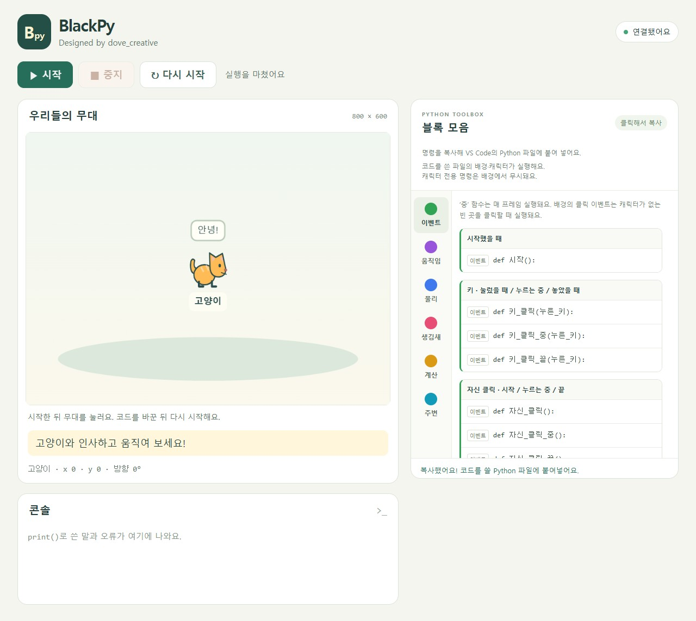

# BlackPy

BlackPy는 배경과 캐릭터마다 작성한 Python 코드를 로컬 웹 무대에서 실행하는 Windows x64 교육용 프로그램이다.

학생은 VS Code에서 일반 `def`와 한글 명령을 작성한다. 웹의 명령 목록을 클릭해 코드를 복사하고, 저장한 코드를 실행해 움직임과 입력 반응을 확인한다.



## 시작하기 전에

현재 형식은 `project.json`과 배경·캐릭터별 Python 파일을 사용한다. 이전 `main.py` 방식과 15개 놀이 예제는 지원하지 않는다. 기존 수업 자료의 영어 API와 실행 예제도 새 형식에 맞게 바꿔야 한다. 학생 파일은 자동 변환하거나 덮어쓰지 않는다.

## 주요 기능

- 캐릭터별 코드: 파일 하나의 명령은 해당 캐릭터에 연결되며 `class`, `self`, `async`, `await`를 직접 쓰지 않는다.
- 클릭해서 코드 복사: 이벤트·움직임·물리·생김새·계산·주변 명령을 VS Code에 붙여 넣는다.
- 시작·유지·종료 이벤트: 키·자신 클릭·캐릭터 접촉과 방송을 처리한다.
- 함께 움직이기: 서로 다른 이벤트는 병행하고, 한 이벤트의 명령은 순서대로 실행한다.
- 프레임에 맞춘 이동: 일반 이벤트는 거리만큼 이동하고, 유지 이벤트는 초당 이동량으로 움직인다.
- 독립된 무대 갱신: C# 실행부가 최대 60Hz로 이동·물리·장면을 갱신하여 Python 처리 중에도 등록된 움직임을 이어 간다.
- 상태 직접 변경: `위치`, `방향`, `속도`, `크기`, `가시성`에 값을 대입한다.
- 실행본 고정: 시작할 때 설정과 등록된 Python 파일 전체를 읽으며 저장한 변경은 다음 실행부터 반영한다.
- 출력·오류 확인: 출력과 이번 실행의 원래 파일·줄 정보를 콘솔에 표시한다.
- 텍스트 입력: 0.1.1에서는 `input()`으로 웹에서 답을 받아 문자열과 숫자 변환을 연습한다.
- 물리 모드: 0.1.1에서는 객체별로 없음·충돌만·물리를 선택하고 중력·충격·무대 경계 충돌을 사용한다.

캐릭터 접촉과 물리는 회전을 반영하지 않는 사각 범위를 사용한다. 물리 계산은 실행부에 동봉한 Box2D.NET이 담당하며 Python 물리 패키지는 필요하지 않다. 자동 회전과 소리는 제공하지 않는다. 학생 Python은 일반 사용자 권한으로 실행되며, BlackPy는 임의 코드를 격리하는 보안 샌드박스가 아니다.

## 요구 사항과 설치

| 구분 | 요구 사항 |
| --- | --- |
| 배포본 실행 | Windows x64, Python 3.10 이상, 웹 브라우저 |
| 학생 코드 편집 | VS Code 등 Python 파일을 저장할 수 있는 편집기 |
| 소스 빌드·배포 | .NET 10 SDK, PowerShell 7, Git |
| 전체 테스트 | 위 환경과 Node.js 22 이상 |

설치형 wheel과 폴더 배포본을 지원한다. 둘 다 .NET·ASP.NET Core 런타임을 포함하며, BlackPy 외의 Python 실행 의존성은 없다. 설치형은 [PyPI](https://pypi.org/project/blackpy/)에서 설치한다.

설치하고 새 프로젝트를 실행하는 명령은 다음과 같다.

```powershell
python -m pip install blackpy
blackpy new 내프로젝트
blackpy run 내프로젝트
```

학생 프로젝트에는 `project.json`, 배경·캐릭터 Python 파일, VS Code용 `__builtins__.pyi`가 생긴다. 공통 실행부는 설치된 Python 환경에 한 번만 들어간다. `blackpy` 명령을 찾지 못하면 `python -m blackpy`를 사용한다. 설치·편집기 안내는 [Usage](docs/Usage.md), 빌드·PyPI 공개 절차는 [Development](docs/Development.md)에 있다.

이미 설치했다면 같은 Python 환경에서 다음 명령으로 갱신한다. 학생 파일의 직접 실행은 0.1.1부터 제공한다.

```powershell
python -m pip install --upgrade blackpy
```

기존 폴더 배포본은 다음과 같이 만든다.

```powershell
git clone https://github.com/dove-creative/blackpy.git
cd blackpy
./scripts/Publish.ps1
```

출력은 `artifacts/blackpy`이다. 이전 형식의 배포 폴더가 남아 있으면 `-Destination <새 배포 폴더>`를 지정한다. 빌드에는 저장소의 NuGet 패키지를 사용하며, 개발용 소스 서브모듈 전체 초기화는 필수가 아니다.

## 빠른 시작

설치형은 `blackpy run 내프로젝트`, 폴더 배포본은 `실습/시작.exe`로 연다. VS Code에서 해당 프로젝트 폴더를 열고 `고양이.py`를 다음과 같이 저장한 뒤 웹의 시작 버튼을 누른다.

0.1.1 설치형에서는 `project.json`과 같은 폴더의 어느 `.py` 파일이든 VS Code의 'Run Python File' 버튼으로 실행하면 그 프로젝트의 웹 무대가 열린다. VS Code에서 선택한 Python에 BlackPy가 설치되어 있어야 한다. `python 내프로젝트/고양이.py`도 같은 동작이며, 학생 코드에 실행용 `import`를 추가하지 않는다.

실행부의 별도 콘솔 창은 표시하지 않는다. BlackPy의 마지막 브라우저 탭이나 창을 닫으면 약 3초 뒤 실행부도 종료된다. 설치형 명령을 실행한 터미널은 그때까지 기다린다. 폴더 배포본의 `Debug.bat`은 콘솔에서 오류를 확인할 때 사용한다.

```python
def 시작():
    말하기("오른쪽 방향키를 누르고 있어 보세요!")


def 키_클릭_중(누른_키):
    if 누른_키 == "오른쪽":
        방향 = 0
        앞으로(120)
```

무대를 클릭해 초점을 옮긴 뒤 오른쪽 방향키를 누르면 고양이가 초당 120만큼 움직인다. `속도` 배율의 기본값은 1이다. 숫자를 바꿔 저장하고 다시 시작하면 새 속도를 비교할 수 있다.

Python·Pylance 확장을 사용하는 VS Code는 프로젝트의 `__builtins__.pyi`로 `말하기` 등의 이름과 인자를 인식한다. 기존 프로젝트에는 `blackpy editor 프로젝트경로`로 안내 파일을 추가한다. 학생 코드의 `import`나 진단 끄기는 필요하지 않다.

## 주요 API

- 이벤트: `시작`, `키_클릭`·`키_클릭_중`·`키_클릭_끝`, `자신_클릭`·`자신_클릭_중`·`자신_클릭_끝`이다.
- 방송·접촉: `방송하기`, `방송_받기`, `닿았을_때`, `닿는_중`, `닿는_중_종료`이다.
- 움직임: `앞으로`, `왼쪽으로돌기`, `오른쪽으로돌기`, `좌표로`, `바라보기`이다.
- 표현·계산: `말하기`, `기다리기`, `랜덤`, `각도로`, `위치_구하기`, `방향_구하기`이다.
- 물리: `물리_설정`, `무게_설정`, `힘_작용`, `정지`, `닿은_객체_리스트`이다. `힘_작용(90, 6)`은 위쪽으로 한 번 밀며, `정지()` 뒤에도 중력은 계속 작용한다.
- 이름 변경: `이름_정하기("새이름")`은 이번 실행에서 조회와 접촉 목록에 사용할 이름을 바꾼다.

`앞으로(100)`은 일반 이벤트에서 총 100만큼 이동하고, 유지 이벤트에서 초당 100만큼 이동한다. 상태·이벤트 인자와 전체 명령은 [사용 안내](docs/Usage.md)에 있다.

## 실행 예제

[samples](samples/README.md)에 이동·키 입력·클릭·방송·접촉·물리 예제 6개가 있다. BlackPy 0.1.2 이상으로 갱신한 뒤 각 폴더의 `시작.pyw`를 더블클릭하거나 `python -m blackpy run ./samples/01-movement`로 연다. 이전 로컬 0.1.1 wheel에서 물리 명령을 찾지 못하면 위의 갱신 명령으로 공개본을 설치한다. 설치되지 않았으면 샘플 실행기는 설치 방법을 안내한다. 조작 방법과 예상 결과는 예제별 README에 있다.

0.1.1을 설치한 Python에서는 샘플 폴더의 `배경.py`나 캐릭터 파일을 직접 실행해도 된다. 어떤 파일에서 열어도 `project.json`에 등록된 배경·캐릭터 전체를 실행한다.

## 문서

- [Overview](docs/Overview.md): 목적, 구성, 제공 범위
- [Implementation](docs/Implementation.md): 실행 책임, 동시 실행과 종료 경계
- [Usage](docs/Usage.md): 학생 실행, 교사 설정, Python API
- [Development](docs/Development.md): 소스 구성, 서브모듈, NuGet 의존성
- [Testing](docs/Testing.md): 검증 범위, 실행 명령, 결과 기록

## 테스트

저장소 루트에서 순서대로 실행한다. 통합·배포 테스트는 실제 배포본을 사용한다.

```powershell
$env:NUGET_PACKAGES = Join-Path (Get-Location) '.cache/nuget'
./scripts/Verify-Dependencies.ps1
dotnet test tests/BlackThunder.BlackPy.Tests.csproj -c Release
python -m unittest discover -s tests -p 'test_*.py'
./scripts/Publish.ps1
node --test tests/Integration.test.mjs tests/EventIntegration.test.mjs tests/TextInputIntegration.test.mjs tests/BrowserLifetime.test.mjs
node --test tests/Samples.test.mjs
node --test tests/Web*.test.mjs
node tests/Deployment.test.mjs
./scripts/Build-Wheel.ps1
npm.cmd install --prefix .cache/editor-tools --no-package-lock --ignore-scripts pyright
node --test tests/Packaging.test.mjs tests/Editor.test.mjs tests/Launchers.test.mjs tests/DirectRun.test.mjs
```

실제 결과와 환경 제한은 [테스트 문서](docs/Testing.md)가 안내하는 검증 기록에 둔다.

## 라이선스

이 프로젝트는 MIT 라이선스로 배포된다. 자세한 내용은 [LICENSE.md](LICENSE.md)를 참고한다. 동봉한 Box2D.NET의 MIT 고지는 [Box2D.NET.LICENSE.md](packages/Box2D.NET.LICENSE.md)에 있으며 폴더 배포본과 wheel에 함께 포함된다.
