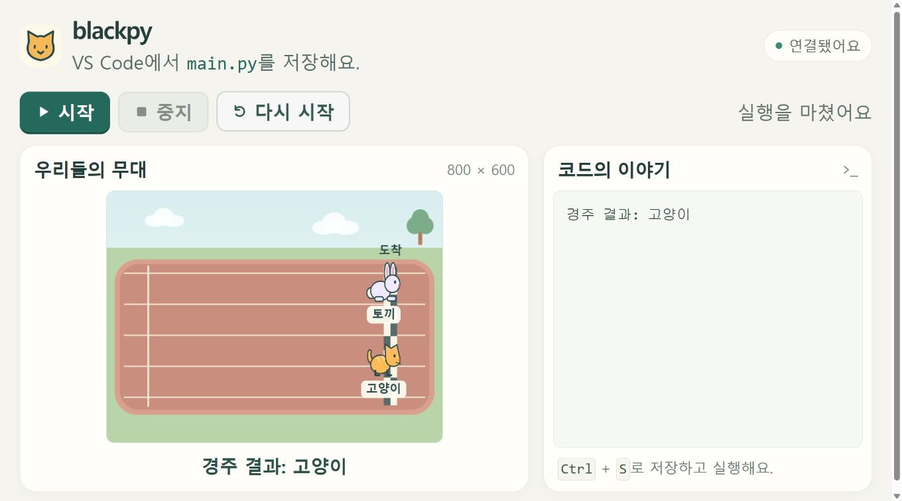

# blackpy

blackpy는 VS Code에서 저장한 Python 코드를 로컬 웹 무대에서 실행하는 Windows x64 교육용 프로그램이다.

학생은 준비된 코드의 숫자와 명령을 바꾸고, 웹 무대에서 캐릭터의 움직임을 확인한다.



## 주요 기능

- 저장한 코드 실행: `main.py`를 저장한 뒤 웹의 시작·중지·다시 시작으로 실행을 제어한다.
- 캐릭터 움직임: 이동·회전·속도를 바꾸고 준비된 경주·드리블 동작을 실행한다.
- 다섯 놀이 예제: 자동차 이동, 댄스 파티, 달리기 경주, 농구공 드리블, 으스스한 숲을 제공한다.
- 출력과 오류 확인: Python 출력과 오류의 파일·줄 정보를 웹에서 확인한다.
- 수업용 배포: .NET 런타임을 포함한 폴더를 만들고, 갱신할 때 학생의 기존 `main.py`를 보존한다.

키보드·클릭 조작, 접촉 판정, 아이템·점수·소리 기능은 아직 제공하지 않는다. 학생 Python은 일반 사용자 권한으로 실행되며, blackpy는 임의 코드를 격리하는 보안 샌드박스가 아니다.

## 요구 사항과 설치

| 구분 | 요구 사항 |
| --- | --- |
| 배포본 실행 | Windows x64, Python 3.10 이상, 웹 브라우저 |
| 학생 코드 편집 | VS Code 등 Python 파일을 저장할 수 있는 편집기 |
| 소스 빌드·배포 | .NET 10 SDK, PowerShell 7, Git |
| 전체 테스트 | 위 환경과 Node.js 22 이상 |

Python 외부 패키지 설치는 필요하지 않다. 배포본에는 .NET·ASP.NET Core 런타임이 포함된다. 소스에서 배포 폴더를 만드는 명령은 다음과 같다.

```powershell
git clone https://github.com/dove-creative/blackpy.git
cd blackpy
./scripts/Publish.ps1
```

출력은 `artifacts/blackpy`이다. 다른 위치는 `-Destination <배포 폴더>`로 지정한다. 실행 방법과 폴더 구성은 [사용 안내](docs/Usage.md)에 있다. 빌드에는 저장소에 포함된 NuGet 패키지를 사용하며, 개발용 소스 서브모듈 초기화는 필수가 아니다.

## 빠른 시작

배포 폴더의 `1. 도시를 가로지르는 자동차/시작.bat`을 실행한다. 같은 폴더의 `main.py`를 아래 코드로 저장하고 웹의 시작 버튼을 누른다.

```python
from blackpy import Actor, stage

stage.background("city")
car = Actor("car", x=-260, y=-140, name="자동차")
car.forward(420)
```

이 코드는 도시 배경에 자동차를 만들고 앞으로 420만큼 이동한다. 숫자를 바꿔 저장한 뒤 다시 시작하면 바뀐 움직임을 확인할 수 있다.

## 주요 API

- `Actor`: 외형·위치·방향·속도를 가진 캐릭터이다.
- `forward`, `backward`, `left`, `right`, `goto`: 이동과 회전을 완료한 뒤 다음 명령으로 넘어간다.
- `stage`: 배경·안내 문구·기다리기와 준비된 동시 움직임을 제공한다.
- `playground.cat`: 기본 고양이 이동 예제의 진입점이다.

## 문서

- [Overview](docs/Overview.md): 목적, 구성, 제공 범위
- [Implementation](docs/Implementation.md): 실행 책임, 상태 변화, 통신과 종료 경계
- [Usage](docs/Usage.md): 실행·배포 방법과 Python API
- [Development](docs/Development.md): 서브모듈, NuGet 의존성, 소스 구성
- [Testing](docs/Testing.md): 검증 범위, 실행 명령, 결과 기록

## 테스트

저장소 루트에서 실행한다. 통합·배포 테스트는 먼저 `Publish.ps1`로 기본 배포본을 준비해야 한다.

```powershell
$env:NUGET_PACKAGES = Join-Path (Get-Location) '.cache/nuget'
dotnet test tests/BlackThunder.BlackPy.Tests.csproj -c Release
python -m unittest discover -s tests -p test_blackpy.py
./scripts/Publish.ps1
node --test tests/Integration.test.mjs
node tests/Deployment.test.mjs
node tests/ActivityDeployment.test.mjs
```

검증 조건과 실행 기록은 [Testing](docs/Testing.md)을 참고한다.

## 라이선스

이 프로젝트는 MIT 라이선스로 배포된다. 자세한 내용은 [LICENSE.md](LICENSE.md)를 참고한다.
